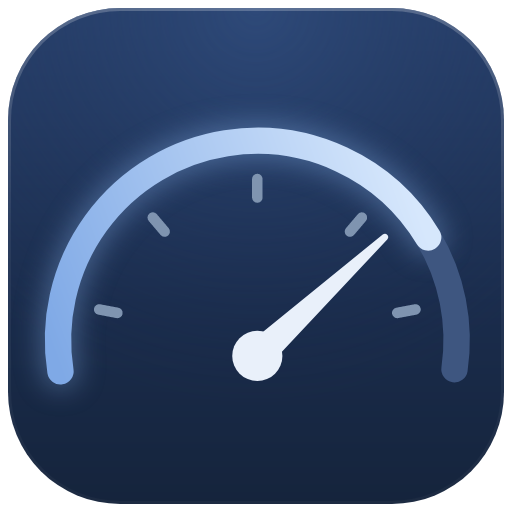
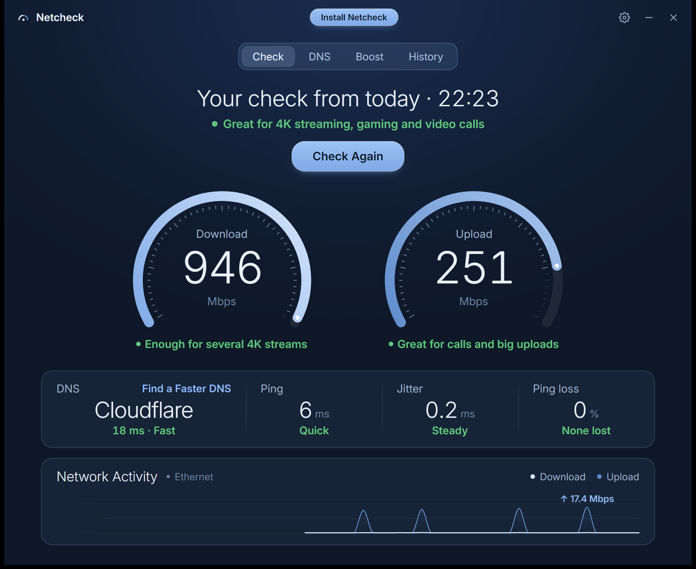
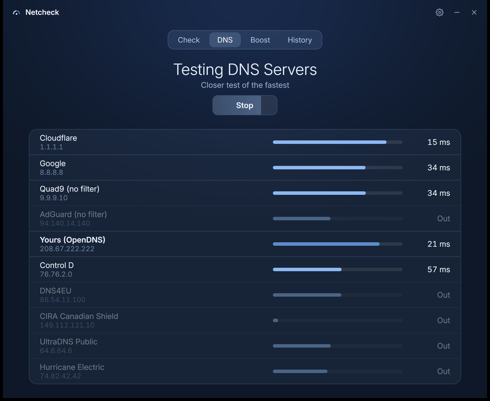
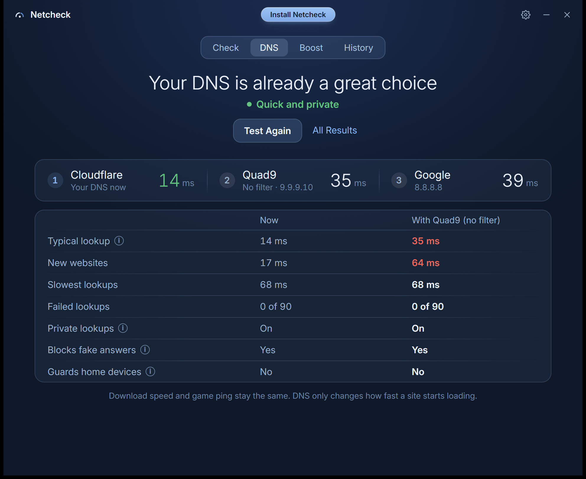
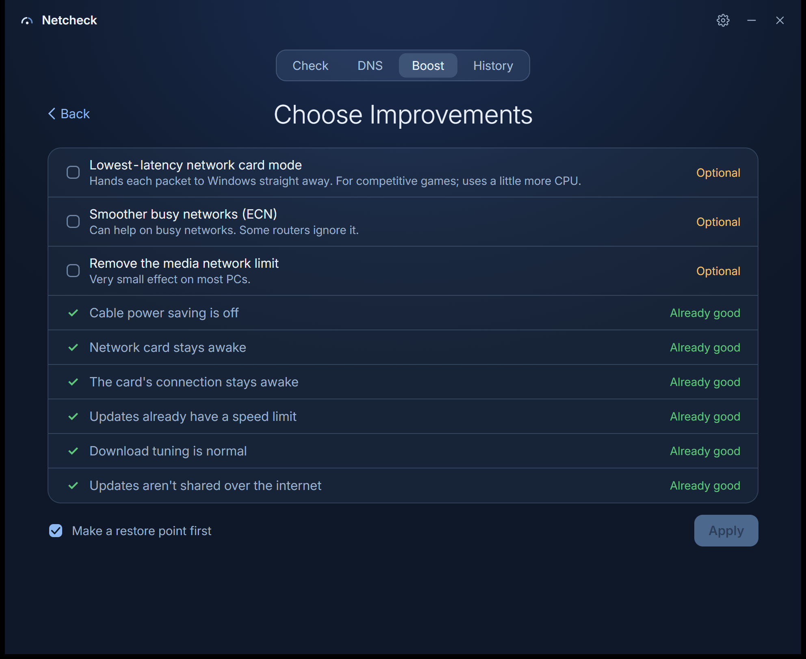
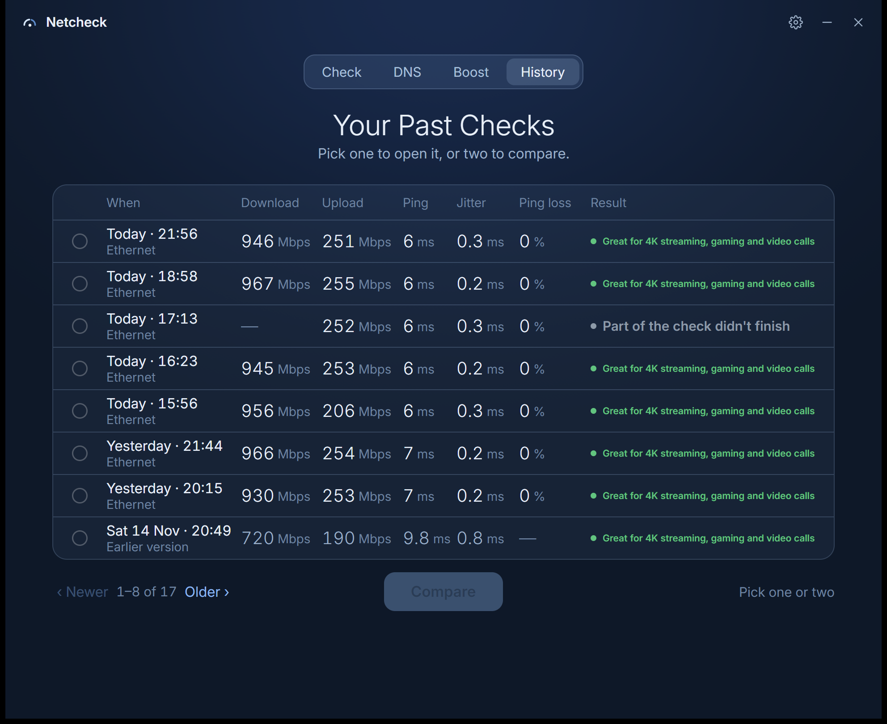

# Netcheck

**Your internet, explained in plain words.** 💙

Netcheck is a free, calm app for Windows. It tells you how good your internet really is, finds the fastest DNS for your PC, and applies a few safe network settings, all in plain words, with one clear button on every screen and an easy way back from every change.

## 💙 Support Netcheck

Netcheck is free, and it stays free. If it helped you and you would like to say thanks, you can support its development on Ko-fi. It is completely optional.

## 🔒 Private by design: we never collect anything about you

Netcheck has **no account, no ads, no tracking and no analytics**. It never collects, stores or sends any information about you or your PC to us or to anyone else. Your checks, your history and your settings stay on your PC, and you can clear them at any time (Settings → Clear History).

The only connections Netcheck makes are the ones a check needs (listed under [What it sends over the internet](#what-it-sends-over-the-internet)): the services it measures see the requests, like any website you visit, and nothing more.

## 📥 Download Netcheck

**Latest version: https://github.com/ShepherdGal/Netcheck/releases/latest.** Download **`Netcheck.exe`** and double-click it. It's one file with nothing to unzip and nothing else to install: everything Netcheck needs is inside it. The installed app updates itself from the same file.

- **Use it straight away (portable):** your checks and settings stay in a `Netcheck Data` folder next to `Netcheck.exe`.
- **Install it:** switching DNS and Boost need the installed app, because they change Windows settings and Windows only lets a locked, installed copy do that. On the portable copy, **Install Netcheck** sits at the top of every screen, above the tabs. Windows asks once for permission, Netcheck is copied to `C:\Program Files\Netcheck` with a Start menu entry, and your portable checks come along (copied; the portable folder isn't changed).

*Requires Windows 10 or 11 (64-bit). Netcheck isn't code-signed yet, so the first time you open it Windows may say **Windows protected your PC**: choose **More info → Run anyway**. Each release lists the SHA-256 fingerprint of the download, so you can check that your copy is the one published here.*

## ✨ What can Netcheck do?

- **Check** — download, upload, ping, jitter and ping loss in about 30 seconds, each with a short meaning in green, yellow or red ("Enough for several 4K streams").
- **DNS** — a short race between well-known DNS services and yours, timed the way each would really be used. Switching, and switching back, takes one click; where the service offers it, your lookups are also made private (encrypted).
- **Boost** — a few safe Windows network settings, with a restore point first, a "Keep these changes?" countdown and **Undo My Boost Changes**. **Things We Don't Change** lists popular tips that don't help.
- **History** — every check is kept on your PC; pick any two to compare before and after.

## 📸 Screenshots

<table>
  <tr>
    <td></td>
    <td></td>
  </tr>
  <tr>
    <td align="center"><b>DNS race</b> · well-known services tested side by side</td>
    <td align="center"><b>DNS result</b> · your DNS now vs. the fastest</td>
  </tr>
  <tr>
    <td></td>
    <td></td>
  </tr>
  <tr>
    <td align="center"><b>Boost</b> · safe settings, always undoable</td>
    <td align="center"><b>History</b> · compare before and after</td>
  </tr>
</table>

## Updates

The installed app can look for a newer version on GitHub at most once a day (you can turn this off in Settings). Nothing downloads until you click **Update Now**. The download is checked against the fingerprint (SHA-256) published with the release before anything changes. The version you had is kept, so **Settings → Go Back** returns to it.

## What Netcheck changes, and how to undo it

- **DNS:** only when you click **Switch to …** or **Make My DNS Private**. The DNS tab then shows **Switch Back to …**, which restores your earlier DNS exactly.
- **Boost:** only the settings you apply. **Undo My Boost Changes** puts the earlier values back. A Windows restore point is made first when you ask for one.
- Every change is read back and checked. After applying, Netcheck asks **Keep these changes?** and puts everything back on its own if you don't answer.
- **Uninstall** (Windows Settings → Apps → Netcheck): if a DNS switch or Boost change is still in place, Netcheck first offers to undo it. Your checks are kept in `%LOCALAPPDATA%\Netcheck`.
- Netcheck doesn't switch DNS on work or school PCs, with a VPN on, or where DNS is set by a policy.

## What it sends over the internet

- **Speed test:** downloads and uploads test data to Cloudflare's public speed test service (`speed.cloudflare.com`) for about 8 seconds each way. On a fast connection a check uses up to about 1 GB, so avoid it on a capped mobile plan. Like any visit to that service, Cloudflare sees your IP address (see [Cloudflare's privacy policy](https://www.cloudflare.com/privacypolicy/)).
- **Ping and ping loss:** small pings to large public services (Cloudflare 1.1.1.1, Google 8.8.8.8, Quad9 9.9.9.9).
- **DNS race:** small name lookups sent to the DNS services being compared, encrypted for services that offer private lookups.
- **Update check:** reads the release list from GitHub. A release downloads only when you click **Update Now**.

That's all. Netcheck itself has no server and receives nothing from you.

Netcheck is an independent project. It isn't made, endorsed or supported by Cloudflare, Google, Quad9, OpenDNS or any other service it measures; their names are used only to say which service a reading belongs to.

## License

Netcheck is free and open source under the [MIT License](LICENSE) (copyright 2026 ShepherdGal): you may use, copy, modify and share it, and it comes without warranty. It uses open-source components (Avalonia, SkiaSharp, HarfBuzz, Microsoft.Data.Sqlite, .NET, the Inter font and others); their licenses are inside the app: **Settings → Open-source licences → Show**.

Developers: see [docs/DEVELOPING.md](docs/DEVELOPING.md).
